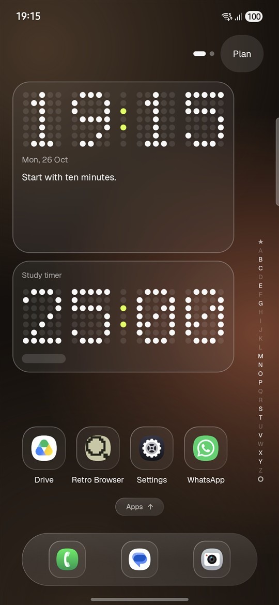
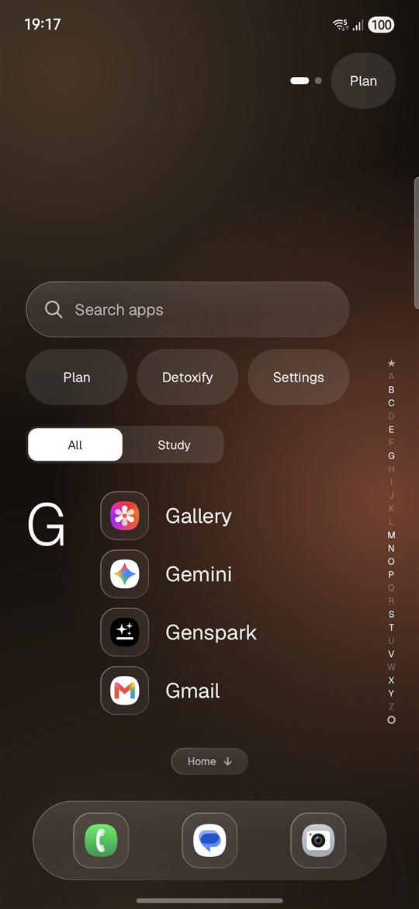
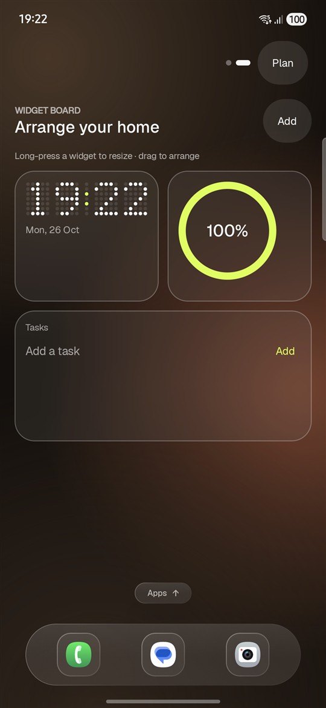
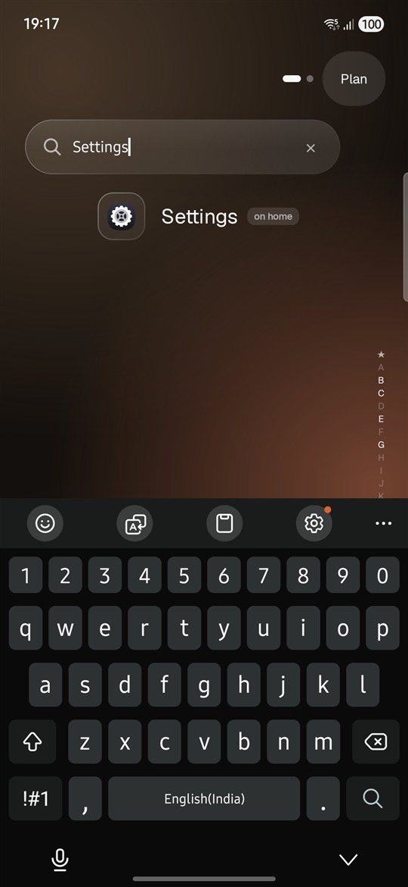
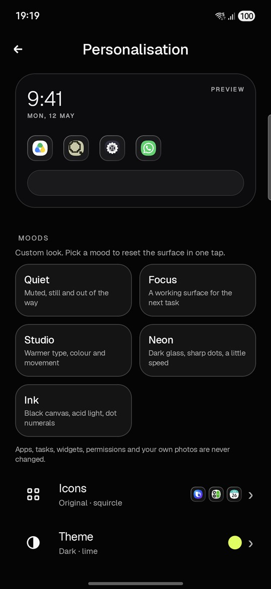
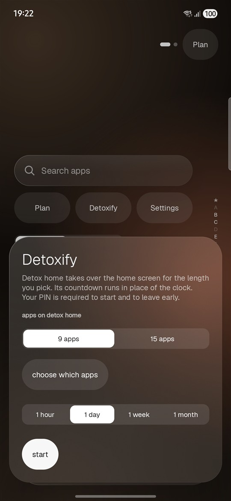

<div align="center">

# Calm UI

**A quiet, open-source Android launcher.**
No ads. No accounts. No tracking. Everything stays on your phone.

[](https://play.google.com/store/apps/details?id=com.studentlauncher)
[](https://github.com/jainam6610/calm-ui/actions/workflows/android.yml)
[](LICENSE)
[](https://kotlinlang.org)
[](#requirements)





</div>

---

Calm UI replaces the home screen with something quieter: a clock you actually like, the next thing on your plate, a handful of apps, and a timer for the work in front of you. It is a real launcher — it hosts widgets, launches apps and can be set as your default home app — built in Kotlin and Jetpack Compose with **zero third-party runtime dependencies**.

It started as a student launcher. It is now for anyone who wants a home screen that stops competing for attention: students, knowledge workers, people cutting down on doomscrolling, or anyone who just wants their phone to feel less loud. The school-oriented widgets are still there if you need them; nothing assumes you are in a classroom.

It is also the app published on Google Play, developed in the open. The Play build is this code; there are no closed-source add-ons.

## Why another launcher?

Most launchers compete for attention. This one removes it:

- **No feed, no suggestions, no ads, no analytics, no account.** The app declares `INTERNET` only for the browser inside Detoxify, so pages *you* open can load. Nothing is uploaded to the developer.
- **Detoxify** is a timed quiet mode (1 hour → 30 days) with a PIN, an allow-list, and a plain-white home that shows only the countdown. Early exit takes the PIN plus a 10-minute wait.
- **Plan** is a local-first task list: title, course or project, due date and priority, stored on the device.
- **Liquid Glass, restrained.** A blurred wallpaper sample, an adaptive tint, a specular rim and a soft shadow on chrome only (dock, sheets, search, menus). Widgets stay flat and readable. The edge-lensing shader is static, Android 13+, and has a same-looking fallback.
- **Everything is yours to change**: 19 clock styles, 5 moods, 7 icon packs, light/dark themes, an accent colour, two dock layouts, wallpapers from a bundled set or your own photos.

## Features

| | |
|---|---|
| **Home** | Clock, date, optional quote, pinned apps in a grid or list, dock or side rail, A–Z scrubber, swipe-up app panel with search. |
| **Widgets** | Clock (dot, digital, words, analog, binary digits, binary dots and more), date, week, battery, next-up, countdown, focus timer, tasks, quick settings, 3D sphere, glyph matrix, plus any installed Android widget. Resize, reorder, edit, remove, undo. |
| **Plan** | Local tasks and events with courses or projects, due dates and priorities. No account, no sync, no server. |
| **Detoxify** | Timed quiet mode with PIN, allow-list, countdown notification, reboot/clock-change survival and a guarded early exit. |
| **Glyph matrix** | A 25 × 25 (489 dot) display that follows the clock, shows charging and plays short event bursts. Event-driven, no idle frame loop. |
| **Icon packs** | Original, Mono, Hairline, Bold, Dot, Bubble, Tile — derived from each app's themed icon layer where it exists. |
| **Privacy controls** | Optional notification metadata signals, call signals, torch reactions and focus reminders — all off by default, each with its own bounded policy and tests. |
| **Accessibility** | Content descriptions and roles on interactive chrome, reduced-motion support, large touch targets, no colour-only meaning. |

### A closer look

<p>
  
  
  
</p>

## Download

<a href="https://play.google.com/store/apps/details?id=com.studentlauncher"></a>

Google Play: **https://play.google.com/store/apps/details?id=com.studentlauncher**

The package ID still reads `com.studentlauncher` — that is the ID the app has shipped under since its first release, and changing it would break updates for existing installs. The product, the code and this repository are Calm UI.

An APK is not distributed from GitHub. Build one yourself in a minute (below) — the debug build uses its own application ID (`com.studentlauncher.debug`) and can sit next to the Play install.

## Requirements

| | |
|---|---|
| Android | 8.0 Oreo (API 26) or newer |
| Build | JDK 17, Android SDK 36 |
| Toolchain | Gradle 8.11.1 · AGP 8.9.1 · Kotlin 2.1.20 · Compose BOM 2025.04.01 |

## Build

```bash
git clone https://github.com/jainam6610/calm-ui.git
cd calm-ui/StudentLauncher
./gradlew assembleDebug          # app/build/outputs/apk/debug/app-debug.apk
./gradlew installDebug           # to a connected device
```

The Android project lives in the `StudentLauncher/` folder, which keeps its original directory name so existing scripts and paths keep working. Open that folder in Android Studio.

Release builds read signing values from `keystore.properties` (ignored by git; copy `keystore.properties.example`). Without it, `assembleRelease` produces an unsigned build and the debug variant still works.

### Tests and checks

```bash
./gradlew testDebugUnitTest lintDebug assembleDebug
```

The suite covers the pure logic behind Detox rules, the PIN policy, widget spans, glyph reactions, clock styles, gestures, focus and notification signals — 170+ tests, no instrumentation required. CI runs the same command on every push and pull request.

## Project layout

This repository is the app plus its engineering record:

```text
StudentLauncher/            Android project (open this folder in Android Studio)
  app/src/main/java/
    com/studentlauncher/    Home, widgets, Plan, app panel, settings, ViewModel
      ui/                   Compose UI, Glass material, icon packs, glyph matrix
      detox/                Timed quiet mode: rules, store, foreground service
      signals/              Optional call/notification signals
      reactions/            Opt-in torch policy and controller
    com/calm/launcher/      Calm/Detox home, browser and notification digest
  app/src/test/             JVM unit tests
  docs/                     Play Store, signing and release notes
  store/                    Listing icon and feature graphic
docs/
  screenshots/              The images in this README
  program/                  Design audit, phase reports, reconciliation
  play-compliance/          Data safety answers, fact sheet, compliance report
privacy.html                Privacy policy (published with GitHub Pages)
index.html                  Small landing page for the policy site
```

## Design and engineering notes

- **One material system.** `ui/Glass.kt` defines `Content` and `Chrome` levels. Content never floats; chrome may lens and cast a shadow. No glass-on-glass stacks, no animated refraction.
- **Persistence is boring on purpose.** `SharedPreferences` + immutable models, with migration tests for stored widget spans.
- **Motion can be turned down.** Every spring and reveal respects a single motion scale; reduced-motion users get instant transitions.
- **The interesting logic is pure and tested.** Detox rules, PIN policy, widget packing, binary clocks, drawer gestures and signal policies live in plain Kotlin files with no Android dependencies, so they are cheap to test.

Read the full design rationale in [`docs/program/DESIGN_AUDIT.md`](docs/program/DESIGN_AUDIT.md).

## Privacy

No accounts, no advertising, no analytics and no third-party SDKs. Settings, tasks, widget content, usage counters and an optional PIN hash are stored in the app's private storage only. Cloud backup and device-to-device transfer are disabled. The only runtime permission requested is notifications, and only when you turn on focus reminders or Detoxify.

The full policy — including the optional notification-metadata listener and the Detoxify browser — is at **[jainam6610.github.io/calm-ui](https://jainam6610.github.io/calm-ui/)** and in [`privacy.html`](privacy.html).

## Contributing

Issues and pull requests are welcome. Start with [`CONTRIBUTING.md`](CONTRIBUTING.md), follow the [Code of Conduct](CODE_OF_CONDUCT.md), and look for the [`good first issue`](https://github.com/jainam6610/calm-ui/labels/good%20first%20issue) label. Security reports go through [`SECURITY.md`](SECURITY.md), not public issues.

If you fork it for your own launcher, keep the privacy promise: local-first, no telemetry, no hidden network calls.

## License

[MIT](LICENSE) © 2026 Jainam Karnawat.

You may use, modify and redistribute this code, including commercially, provided the copyright notice and licence text are kept. The name **Calm UI**, its icon and store listing are not covered by the code licence.

## Author

**Jainam Karnawat** — Android developer.

- GitHub: [@jainam6610](https://github.com/jainam6610)
- Instagram: [@thats.jainam_dev](https://instagram.com/thats.jainam_dev) · [@thats.jainam](https://instagram.com/thats.jainam)
- Google Play: [Calm UI](https://play.google.com/store/apps/details?id=com.studentlauncher)

If this project helped you, a star helps someone else find a quieter home screen.
